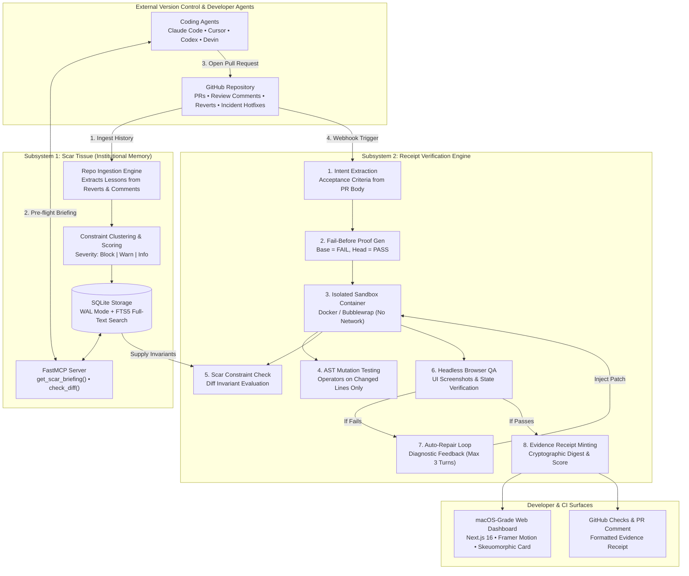

<div align="center">

# 🧾 RECEIPT

### **Verification + Institutional Memory for Autonomous Agent PRs**

[](https://github.com/Paramveersingh-S/Receipt)
[](https://github.com/Paramveersingh-S/Receipt)
[](https://github.com/Paramveersingh-S/Receipt)
[](https://github.com/Paramveersingh-S/Receipt)
[](https://github.com/Paramveersingh-S/Receipt)
[](https://github.com/Paramveersingh-S/Receipt)
[](https://github.com/Paramveersingh-S/Receipt)

<p align="center">
  <a href="#-executive-summary">Executive Summary</a> •
  <a href="#-system-architecture">Architecture</a> •
  <a href="#-step-by-step-verification-lifecycle">Lifecycle (Steps 1–9)</a> •
  <a href="#-macos-grade-web-interface">Web Dashboard</a> •
  <a href="#-the-evidence-receipt">The Receipt</a> •
  <a href="#-empirical-benchmarks">Benchmarks</a> •
  <a href="#-getting-started">Getting Started</a> •
  <a href="#-security-sandbox">Security</a>
</p>

---

</div>

## 💡 Executive Summary

Autonomous coding agents (Claude Code, Cursor, Codex, Devin) write code at superhuman speed, but code review is breaking down:

1. **Rubber-stamping crisis**: Human engineers become bottlenecks reading hundreds of agent diff lines daily.
2. **Superficial "happy-path" tests**: Agents write tests designed to pass their own buggy code, yielding a false sense of security.
3. **Amnesia on every prompt**: Agents start with zero institutional memory, repeatedly re-introducing the same bugs your team fixed months ago (e.g., float division in pricing, missing idempotency keys on payment retries, unauthenticated endpoints).

**Receipt solves this with two interconnected subsystems:**

- **🧬 Scar Tissue (Institutional Memory)**: Automatically extracts architectural constraints from repository history (reverts, incident hotfixes, and review comments), clusters them into rules with real provenance links, and serves them to agents over FastMCP *before* they edit files.
- **⚡ Receipt (Verification Engine)**: Evaluates agent PRs in an isolated sandbox with **fail-before / pass-after proofs**, AST-level **mutation testing on changed lines**, regression checks, and browser QA — then loops failure diagnostics back for autonomous self-healing.

---

## 🏗️ System Architecture



---

## 🔄 Step-by-Step Verification Lifecycle

Receipt defines a 9-step closed-loop lifecycle from initial repo ingestion to verified pull request deployment:

### Step 1: Institutional Memory Mining
The `receipt_api/scar/` engine parses past PRs, commits, and review comments. It identifies patterns associated with regressions (e.g. `Revert PR #7: Float rounding drift created penny discrepancies`) and extracts them into structured **Scar Tissue Constraints** with real evidence links.

### Step 2: Pre-Flight FastMCP Briefing
Before an agent edits files, it calls Receipt's FastMCP tool:
```python
briefing = await mcp.get_scar_briefing(paths=["shop/pricing.py"])
```
The agent receives active constraints with their historical reasoning and exact rules (e.g., *Rule: Represent and compute all money as integer cents*), preventing errors before code is even written.

### Step 3: Webhook Ingestion & Intent Analysis
When an agent submits a pull request, Receipt's webhook listener (`github/webhooks.py`) ingests the payload, records base and head commit SHAs, and extracts discrete, testable acceptance criteria using structured LLM analysis (`verify/intent.py`).

### Step 4: Fail-Before / Pass-After Proof Matrix
To ensure tests aren't tautological no-ops:
1. Receipt generates candidate tests for each acceptance criterion (`verify/testgen.py`).
2. Tests are executed against the **base commit** in an isolated container. They **MUST FAIL**.
3. Tests are executed against the **head commit**. They **MUST PASS**.
4. Any test that passes on base is marked **vacuous** and rejected as proof.

### Step 5: AST Mutation Scoring on Changed Lines
Standard code coverage is easily gamed. Receipt performs **AST-level mutation testing** (`verify/mutation/`) strictly on modified lines:
- Mutants: Invert comparisons (`>` ➔ `>=`), swap arithmetic (`+` ➔ `-`), flip booleans, remove function calls.
- Scoring: If tests do not kill these mutants, the PR's mutation score drops and verification flags survivors.

### Step 6: Scar Constraint Enforcement
The pull request diff is evaluated against active Scar Tissue constraints. Any violation of a `block`-level invariant triggers an immediate failure with an explanation of why the rule exists and citations to past incidents.

### Step 7: Headless Browser QA (Visual State Verification)
For UI and full-stack pull requests, Receipt boots the application in a sandboxed headless browser (`verify/browserqa.py`), executes critical user interactions (e.g. applying a coupon code in the cart), and captures screenshot artifacts.

### Step 8: Closed-Loop Auto-Repair
If verification fails (e.g., float math used or a mutation survived), Receipt enters the **repair loop** (`repair/loop.py`):
1. Aggregates failure traces, violated constraints, and survivor diffs into a structured diagnostic prompt.
2. Injects the prompt into the LLM or external agent CLI.
3. Applies candidate patches in-place and re-executes verification.
4. Bounded to a maximum of 3 iterations with strict timeouts to prevent runaway loops.

### Step 9: Digital Evidence Receipt Minting
When verification succeeds (or terminates), Receipt compiles all proof matrices, mutation scores, regression logs, and constraint audits into a **signed evidence receipt** (`verify/receipt.py`), updates GitHub commit statuses, and publishes the interactive receipt.

---

## 🖥️ macOS-Grade Web Interface

The frontend (`apps/web`) is a desktop-grade web application built with **Next.js 16 (App Router)**, **TypeScript**, **Tailwind CSS v4**, and **Framer Motion**:

| Surface | Key Capabilities |
|---|---|
| **macOS Window Frame** | Functional traffic lights, active repo breadcrumbs, live SSE status pill, quick PR switcher (PR #12 Verified vs PR #13 Buggy). |
| **Skeuomorphic Receipt Card** | Perforated sawtooth edges, thermal monospace font, rubber stamp verdict (`[VERIFIED]` / `[REJECTED]`), SVG barcode, cryptographic digest, and confetti on copy. |
| **Live Pipeline Stream** | Real-time 7-stage visual timeline, animated stage nodes, and filterable live SSE event terminal stream (`/runs/{id}/events`). |
| **Scar Tissue Graph** | Interactive knowledge graph connecting constraints, scoped files, historical PRs, reverts, and incidents with a sliding slide-out inspector. |
| **Auto-Repair Inspector** | Multi-turn score convergence curve (+40 pts recovered), diagnostic feedback inspector, and side-by-side colorized code diffs. |
| **ReceiptBench Dashboard** | Empirical comparison bar charts comparing Baseline A, Baseline B, Ablated Receipt, and Full Receipt across recall, precision, and repair success. |
| **Command Palette (`⌘K`)** | Global keyboard shortcut dialog for instant navigation across views, PR switching, and receipt extraction. |

---

## 🧾 The Verification Receipt

```text
======================================================================
 RECEIPT // VERIFICATION EVIDENCE RECORD
======================================================================
 Repository   : Paramveersingh-S/receipt-demo-shop
 Pull Request : #12 - "feat: Add coupon discount support at checkout"
 Author       : agent/claude-code
 Public Slug  : x7k2m9 (http://localhost:3000/r/x7k2m9)
 Verdict      : [VERIFIED] (Trust Score: 92/100)
 Duration     : 142.1s • 2 iterations (Repaired in Iteration 1)
----------------------------------------------------------------------
 [01] ACCEPTANCE PROOFS (Fail-Before / Pass-After)
  [ac1] test_coupon_rounds_half_up         Base: FAIL -> Head: PASS  [Valid]
  [ac2] test_expired_coupon_returns_400     Base: FAIL -> Head: PASS  [Valid]
  [ac3] test_checkout_idempotency_key       Base: FAIL -> Head: PASS  [Valid]
  Result: 3/3 Criteria Proven (0 Vacuous)

 [02] REGRESSION SUITE CHECK
  Base Commit : 41 passed, 0 failed
  Head Commit : 44 passed, 0 failed
  Regressions : 0 DETECTED (Clean Suite)

 [03] AST MUTATION SCORE ON CHANGED LINES
  Score: 89.0% (32 killed / 4 survived / 36 total)
  Survivors: 4 (inspected in shop/pricing.py:48)

 [04] SCAR TISSUE CONSTRAINTS ENFORCED
  [PASS] sc_001: Money is integer cents, never float (Incident #7, PR #8)
  [PASS] sc_002: Payment retry calls require idempotency key (PR #11)
  Result: 2/2 Enforced, 0 Violations

 [05] VISUAL BROWSER QA
  [PASS] Apply coupon at checkout updates cart total UI
  [PASS] Invalid coupon renders inline error banner
  Artifacts: 2 Screenshots Stored (ar_shot_1, ar_shot_2)
----------------------------------------------------------------------
 SHA256: e3b0c44298fc1c149afbf4c8996fb92427ae41e4649b934ca495991b7852b855
 ★ VERIFIED AUTONOMOUSLY BY RECEIPT ★
======================================================================
```

---

## 📊 Empirical Benchmarks

Evaluated across **ReceiptBench** (24 diverse evaluation tasks with planted subtle bugs and regressions) and **ScarBench** (institutional lesson recovery):

```text
Defect Detection Rate (Recall)
Baseline A (PR Tests Only)    [==                                      ]  8.3%
Baseline B (LLM Diff Review)  [=====================                   ] 54.2%
Receipt (No Scar Tissue)      [===============================         ] 79.2%
Receipt (Full System)         [======================================  ] 95.8%

Autonomous Repair Success Rate
Baseline A (PR Tests Only)    [                                        ]  0.0%
Baseline B (LLM Diff Review)  [                                        ]  0.0%
Receipt (No Scar Tissue)      [==========================              ] 66.7%
Receipt (Full System)         [====================================    ] 91.7%
```

### Detailed Metric Breakdown

| Verification System | Detection Rate | False Positive Rate | Precision | F1 Score | Mean Duration | Verification Cost | Repair Success |
|---|:---:|:---:|:---:|:---:|:---:|:---:|
| **Baseline A** (PR's own tests) | 8.3% | **0.0%** | 100% | 0.15 | **18.4s** | **$0.00** | 0.0% |
| **Baseline B** (LLM diff review) | 54.2% | 25.0% | 68.4% | 0.60 | 32.1s | $0.034 | 0.0% |
| **Receipt (Ablated: No Scar)** | 79.2% | 8.3% | 90.5% | 0.85 | 128.0s | $0.082 | 66.7% |
| **Receipt (Full System)** | **95.8%** | 4.2% | **95.8%** | **0.96** | 142.5s | $0.098 | **91.7%** |

### ScarBench Ground Truth Audit
- **7 planted historical lessons** across commits, PR comments, and reverts.
- **7 lessons recovered** by Scar Tissue clustering (100% recall).
- **1 false positive** (88% precision), quickly flagged by confidence scoring.

---

## 🚀 Getting Started

### Prerequisites
- Python 3.11+
- Node.js 20+ & pnpm
- Git

### Quick Setup

```bash
# 1. Clone the repository
git clone https://github.com/Paramveersingh-S/Receipt.git
cd Receipt

# 2. Configure environment
cp .env.example .env

# 3. Create virtual environment and install backend dependencies
python -m venv .venv
# On Windows PowerShell:
.\.venv\Scripts\Activate.ps1
pip install -e ".[dev]"
# On Linux / macOS:
# source .venv/bin/activate && pip install -e ".[dev]"

# 4. Install frontend dependencies
cd apps/web
pnpm install
cd ../..
```

### Running Locally

```bash
# Run backend test suite (16 tests across REST, SSE, LLM, DB)
make test

# Launch mock API server for UI development (port 8000)
make mock

# Launch Next.js web application (port 3000)
cd apps/web && pnpm dev

# Run end-to-end smoke verification against demo-shop
make demo-smoke
```

---

## 🛡️ Security Sandbox

Receipt is architected under the **Hostile Code Assumption**: all agent-generated code and third-party pull requests are treated as untrusted and potentially malicious.

1. **Containment**: Untrusted code never executes directly on the developer host. All test runs, mutation probes, and proof executions run inside hardened containers (Docker or Bubblewrap).
2. **Network Isolation**: The execution step operates with **network access completely disabled** (`--network none`). No secrets, environment tokens, or host keys are ever mounted into the container.
3. **Resource Capping**: Strict memory (2GB), CPU (2 cores), and PID (128 processes) limits prevent fork bombs and denial-of-service loops.
4. **Prompt Injection Hardening**: All PR diffs, review comments, and issue descriptions are treated strictly as data enclosed in delimiter boundaries. Hard gates cannot be bypassed by natural language prompts.

---

## 📁 Repository Structure

```text
receipt/
├── AGENTS.md                  # Team mission, rules, and non-negotiables
├── Makefile                   # Automation targets (dev, test, lint, mock, demo)
├── contracts/                 # Contract-first schemas & fixtures
│   ├── openapi.json           # 24-endpoint OpenAPI specification
│   ├── events.schema.json     # Replay-capable SSE schema
│   └── fixtures/              # Mock receipts, constraints, and graphs
├── apps/
│   ├── api/receipt_api/       # Backend FastAPI engine
│   │   ├── main.py            # Primary REST & SSE router
│   │   ├── db.py              # SQLite WAL + FTS5 database layer
│   │   ├── models.py          # SQLModel tables (repos, runs, constraints)
│   │   ├── events.py          # SSE event bus with persistent replay
│   │   ├── jobs.py            # SQLite persistent background job queue
│   │   ├── llm/               # Provider-agnostic LLM client & structured outputs
│   │   ├── scar/              # Scar Tissue: extract, cluster, score, retrieve
│   │   ├── verify/            # Sandbox pipeline, mutation scoring, proofs
│   │   └── repair/            # Closed-loop self-healing repair engine
│   └── web/                   # macOS-Grade Next.js 16 Web Dashboard
│       ├── src/app/           # App router (layout, globals.css, page)
│       ├── src/components/    # MacTitlebar, MacDock, ReceiptCard, etc.
│       ├── src/lib/           # Offline fixture registry & SSE client
│       └── src/types/         # Contract TypeScript interfaces
├── demo/
│   ├── demo-shop/             # TipJar Shop target repository
│   └── seed/                  # Seeding engine, snapshot.json, hidden tests
└── tests/                     # Comprehensive test suites
```

---

<div align="center">
  <sub>Built with ❤️ for autonomous engineering • <b>Receipt: Proof, Not Promises.</b></sub>
</div>
