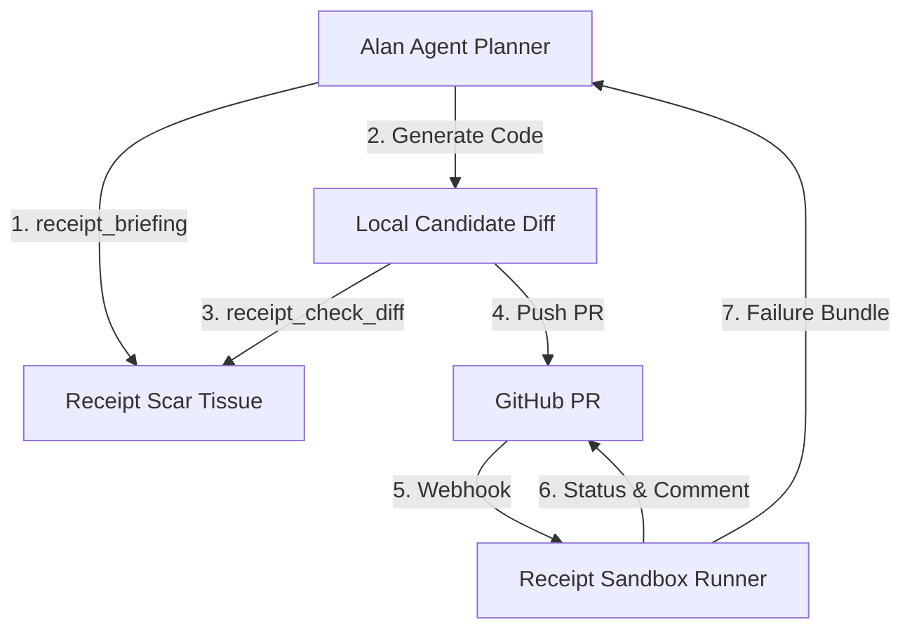

# Alan AI Agent Integration Guide

Connect **Alan AI** automated PR workflows and autonomous developers directly to **Receipt Verification & Institutional Memory Engine**.

---

## Architecture Overview

Receipt acts as the zero-trust verification and institutional memory layer for Alan-generated pull requests:
1. **Pre-flight Briefing**: Alan queries Receipt MCP before planning code modifications.
2. **Pre-commit Diff Check**: Alan validates code changes locally against institutional invariants.
3. **Webhook Verification**: On PR creation, GitHub triggers `receipt/verify` commit status.
4. **Autonomous Self-Repair**: If verification fails, Alan consumes the structured failure bundle (`receipt_feedback`) to repair errors without developer intervention.



---

## Webhook Endpoint

### `POST /integrations/alan/verify`

Triggered directly by Alan orchestrator or GitHub Actions:

**Request Payload:**
```json
{
  "repo": "Paramveersingh-S/receipt-demo-shop",
  "pr": 42,
  "base_sha": "abc1234",
  "head_sha": "def5678",
  "task": "Add support for 15% promotional coupons",
  "agent_id": "alan-dev-agent-v2"
}
```

**Response Payload:**
```json
{
  "status": "enqueued",
  "agent": "alan",
  "receipt_url": "http://localhost:3000/r/rcpt_demo_42",
  "verification_context": "receipt/verify",
  "summary": "Sandbox verification initiated for Alan PR #42"
}
```

---

## Consuming Failure Bundles via MCP

When a PR receives verdict `NEEDS_REVIEW` or `REJECTED`, Alan retrieves the diagnostic bundle:

```python
# Alan agent Python tool invocation
failure_bundle = mcp.call_tool("receipt_feedback", {"run_id": "run_1730000000"})
```

The returned failure bundle contains:
- Exact failed test tracebacks.
- Violated Scar Tissue invariants with links to past incident PRs.
- Mutants on changed lines that survived the test suite.
- Anti-cheating guardrails (disallowing `@pytest.mark.skip` or `assert True`).

Alan generates an updated unified diff and pushes it to the PR branch, automatically triggering re-verification.
