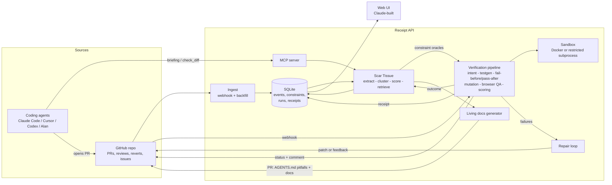

# Architecture — Receipt

## System Overview

Receipt is an automated verification and institutional memory engine for agent-written code. It operates across two tightly coupled subsystems:
1. **Scar Tissue (Institutional Memory)**: Analyzes historical GitHub activity (merged PRs, code reviews, revert commits, bugfix and incident resolutions) to extract, cluster, score, and retrieve repository-specific invariants and constraints. Exposes constraints to coding agents via Model Context Protocol (MCP) and diff checking before code merges.
2. **Receipt (Verification Engine)**: Executes automated verification pipelines on candidate PRs inside an isolated sandbox. Generates acceptance criteria from PR intent, generates stack-tailored tests, verifies behavioral proof (must fail on base commit, pass on head commit), measures AST-level mutation coverage on modified hunks, enforces learned constraints, and detects regression in existing test suites.

## Core Subsystems

### 1. Ingestion & Event Storage (`receipt_api/github/`)
- Webhook listener for GitHub PR lifecycle (`opened`, `synchronize`, `closed`, `reopened`).
- Historical backfill: Ingests PR discussions, inline review comments, revert commits, and hotfixes.
- Normalizes events into `gh_events` table for reproducible offline replay.

### 2. Memory Engine — Scar Tissue (`receipt_api/scar/`)
- **Mining & Extraction**: Identifies candidate lessons from code review comments, reverts, and bugfixes.
- **Deduplication & Clustering**: Combines related lessons into canonical constraints with full provenance links.
- **Scoring**: Computes confidence scores based on recency, frequency of occurrence, and severity.
- **Retrieval**: Hybrid retrieval combining SQLite FTS5 (BM25) and vector similarity, filtered by path scope.
- **Static & Dynamic Oracles**: Enforces constraints via AST rules (e.g. monetary float detection) and dynamic checks.

### 3. Verification Pipeline (`receipt_api/verify/`)
- **Intent Analysis**: Extracts discrete acceptance criteria from PR descriptions and tickets.
- **Test Generation**: Generates targeted tests validating specific acceptance criteria.
- **Fail-Before / Pass-After**: Runs generated tests against both base and head SHAs. Tests passing on base are marked *vacuous* and discarded as proof of improvement.
- **Regression Detection**: Executes repo test suite on base and head to ensure no regression.
- **Targeted Mutation Testing**: Generates mutants specifically on modified code hunks to ensure tests actually validate altered logic.
- **Scoring & Receipt Generation**: Calculates composite score and generates an immutable, cryptographically verifiable receipt record.

### 4. Sandbox Runner (`receipt_api/verify/sandbox.py`)
- Executes untrusted code with resource limits (time, memory, CPU, pids).
- Backend options: Isolated Docker container or restricted subprocess with scrubbed environment and disabled network access during test runs.

### 5. Closed-Loop Repair (`receipt_api/repair/`)
- Assembles detailed failure bundles (failed assertions, surviving mutants, violated constraints).
- Interfaces with LLM patchers or external agent loops (MCP feedback) to iteratively reach verified status within capped attempts.
