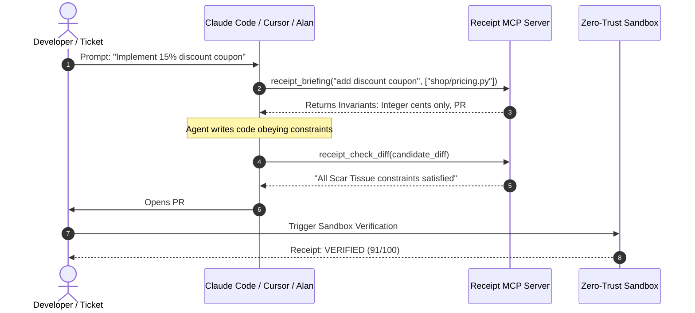

# Receipt MCP Server Setup Guide

Connect external AI coding agents (**Claude Code**, **Cursor**, **Codex**, **Antigravity**, **Alan**) directly to **Receipt Verification & Institutional Memory Engine** via the Model Context Protocol (MCP).

---

## 🛠️ Available MCP Tools & Resources

### Tools
1. **`receipt_briefing(task, paths)`**: Generates a pre-coding briefing with institutional constraints, traps, and suggested verification tests before the agent writes code.
2. **`receipt_check_diff(diff)`**: Evaluates candidate unified git diff against AST static invariant checks (float money, bare exceptions, missing idempotency, N+1 queries, unauthenticated endpoints).
3. **`receipt_verify_pr(repo, pr)`**: Triggers or queries full zero-trust sandbox verification (fail-before/pass-after proofs, regression, mutation score, invariant checks, browser QA).
4. **`receipt_get_receipt(id)`**: Fetches interactive verification receipt markdown by ID or public slug.
5. **`receipt_feedback(run_id)`**: Fetches structured failure bundle (failing proofs, test tracebacks, violated constraints, surviving mutants) for agent self-repair.
6. **`receipt_report_outcome(receipt_id, decision, note)`**: Reports merge decision (`merged`, `rejected`, `overridden`) to update Scar Tissue confidence scoring in the learning loop.
7. **`scar_search(query)`**: Performs hybrid semantic + BM25 search across repository lessons and past incident tickets.

### Resources
- **`scar://constraints/{path}`**: Dynamic context resource returning active institutional constraints affecting a target file path.

---

## 🚀 Client Configuration Snippets

### 1. Claude Code
Add to your project's `claude.json` or run the CLI command:

```bash
claude mcp add receipt python /path/to/receipt/mcp_server.py
```

Or configure in `~/.claude.json`:
```json
{
  "mcpServers": {
    "receipt": {
      "command": "python",
      "args": ["/absolute/path/to/receipt/mcp_server.py"],
      "env": {
        "RECEIPT_DATABASE_URL": "sqlite:///data/receipt.db"
      }
    }
  }
}
```

### 2. Cursor IDE
Create or edit `.cursor/mcp.json` in your workspace root:

```json
{
  "mcpServers": {
    "receipt": {
      "command": "python",
      "args": ["${workspaceFolder}/mcp_server.py"]
    }
  }
}
```

### 3. Google Antigravity IDE
Configure in `~/.gemini/antigravity-ide/mcp_config.json` or `.agents/mcp_config.json`:

```json
{
  "mcpServers": {
    "receipt": {
      "command": "python",
      "args": ["D:/Projects/openfire/mcp_server.py"],
      "transport": "stdio"
    }
  }
}
```

### 4. Direct Testing with MCP Inspector
Inspect and interactively test tools and resources with the official MCP Inspector:

```bash
npx @modelcontextprotocol/inspector python mcp_server.py
```

---

## 🔄 Agent Pre-flight & Repair Lifecycle


